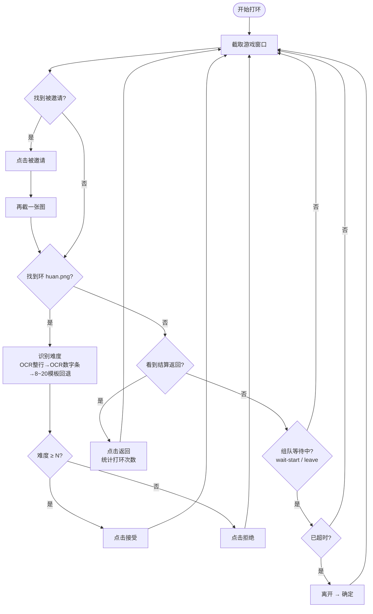
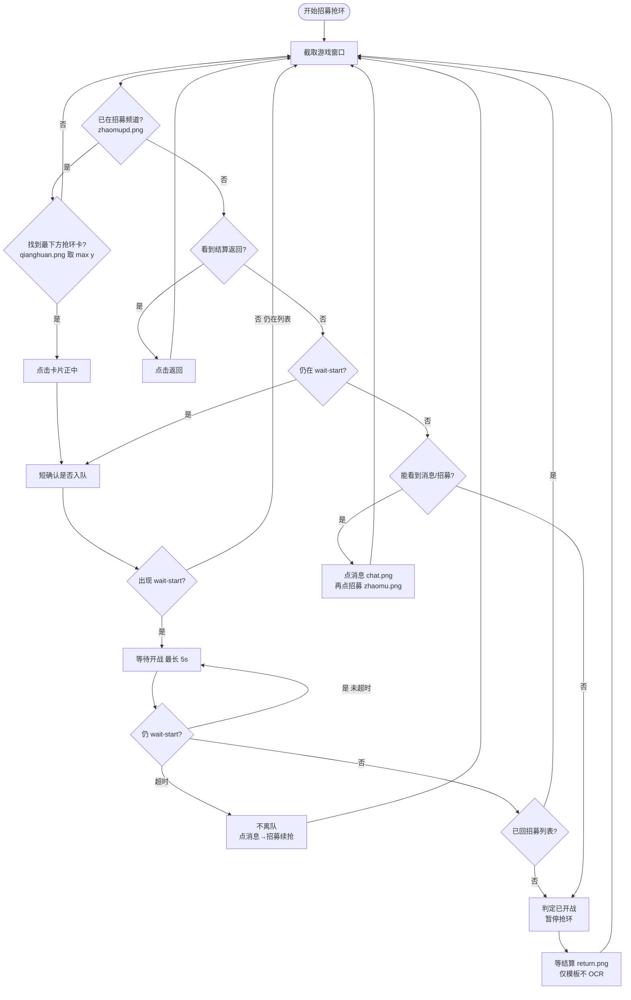

`微信小游戏-向僵尸开炮` 自动化脚本  
利用窗口截图 + 模板匹配 / OCR 实现功能。

## 功能说明

四个功能**互斥、彼此独立**：同一时刻只能运行其中一个；各自流程均为**串行**（功能内部不再开并行子线程）。

| 功能 | 流程概要 |
|------|----------|
| **打环** | 被邀请 → 找环（OCR / 数字模板认难度，≥N 接受否则拒绝）→ 结算返回 → 组队等待 / 超时离队 |
| **扫荡** | 开始游戏 → 刷技能 → 达标退出本局 → 结算返回 → 循环 |
| **主动邀请** | 邀请加号 → 好友页 → 邀好友 / 一键邀请 → 开始游戏 → 等结算返回 → 再邀 |
| **招募抢环** | 消息 → 招募 → 点最下方寰球救援卡 → 等开战；5s 未开战则点消息回招募续抢；开战则等结算后再抢 |

## 流程图

顺序与 `base/Controller.py` 主循环一致。

### 1. 打环（`_run_huan`）

### 2. 扫荡（`_run_saodang`）

### 3. 主动邀请（`_run_me_invite`）

### 4. 招募抢环（`_run_qianghuan`）

## 模板图片一览

模板放在 `image/`（打包后同样从此加载）。匹配用 OpenCV；失败时部分步骤会 OCR 兜底。  
同一张图可能出现在多个功能表中。

### 1. 打环

| 文件名 | 对应界面/按钮 | 用途说明 |
|--------|----------------|----------|
| `bei-yaoqing.png` | 「副本邀请」入口（被邀请） | **点击**打开被邀请组队界面，打环第一步 |
| `huan.png` | 「寰球救援-难度」标题（无末尾数字） | **识别**环任务位置；难度在其右侧 OCR / 模板 |
| `8.png`～`20.png` | 带数字的整行样本 | OCR 失败时**模板回退**识别难度 |
| `ok.png` | 邀请卡右侧黄色「接受」 | 难度达标后**点击**接受进队 |
| `wait-start.png` | 组队「等待开始」 | **识别**仍在等人开战的大厅（超时离队） |
| `leave.png` | 组队「离开」 | 超时未开战时**点击**离队 |
| `leave-ok.png` | 离队确认「确定」 | **点击**确认离开队伍 |
| `return.png` | 结算页黄色「返回」 | **点击**退出结算并统计打环次数 |

### 2. 扫荡

| 文件名 | 对应界面/按钮 | 用途说明 |
|--------|----------------|----------|
| `open-game.png` | 「开始游戏」 | **点击**开局进入战斗 |
| `shuaxin.png` | 战斗内「刷新」 | **点击**刷新技能，累计次数后触发退出 |
| `tuichu.png` | 扫荡退出按钮 | 刷新达标后**点击**退出本局 |
| `return.png` | 结算页黄色「返回」 | **点击**退出结算，准备下一局 |

### 3. 主动邀请

| 文件名 | 对应界面/按钮 | 用途说明 |
|--------|----------------|----------|
| `invite-plus.png` | 组队大厅邀请条左侧金色「+」 | **点击**打开邀请弹层（要点加号） |
| `me-invite.png` | 组队大厅整块「邀请」条 | 加号失败时**点击**条左侧约 20%（加号位置） |
| `publish-recruit.png` | 推荐页绿色「发布招募」 | **仅识别**：有此按钮=仍在「推荐」页 |
| `friend.png` | 底部「好友」页签（推荐页未选中、棕色） | **点击**切换到好友列表 |
| `all-invite.png` | 橙色「一键邀请」 | 识别弹层/好友页；未填好友名时**点击**一键邀请全部 |
| `inv_friend.png` | 好友列表行右侧黄色「邀请」 | **点击**指定好友旁邀请；也可确认列表已出现 |
| `friends/target.png` | 目标好友名字截图 | UI 临时粘贴/拖拽；按模板查找该好友 |
| `open-game.png` | 「开始游戏」 | **点击**开战（与扫荡共用）；成功后暂停邀人直到结算 |
| `return.png` | 结算页黄色「返回」 | 开战中轮询，**点击**返回后再继续邀人 |

### 4. 招募抢环

| 文件名 | 对应界面/按钮 | 用途说明 |
|--------|----------------|----------|
| `chat.png` | 大厅「消息」按钮 | **点击**打开聊天；超时未开战时也点这里回招募 |
| `zhaomu.png` | 聊天侧「招募」入口 | **点击**进入招募频道 |
| `zhaomupd.png` | 左侧「招募」选中态标题 | **仅识别**：已在招募频道 |
| `qianghuan.png` | 卡片上「寰球救援-难度」 | **识别**全部匹配后取最下方一张，点卡片正中 |
| `wait-start.png` | 组队「等待开始」 | **识别**入队成功 / 仍在等人开战 |
| `return.png` | 结算页黄色「返回」 | 开战后**仅模板**点击（不用 OCR），再继续抢环 |

### 未使用

| 文件名 | 说明 |
|--------|------|
| `team-invite.png` | 目录内有图，代码未引用；主动邀请弹层用 OCR「组队邀请」等判断 |
| `yeshuan.png` | 目录内有图，代码未引用 |

### 截图建议

- 游戏窗口固定约 `418×803` 后再截，尽量只裁目标按钮/标题。  
- `bei-yaoqing.png`：截别人发来的「副本邀请」入口（打环用，需可点击匹配）。  
- `huan.png`：只截到「难度」二字为止，**不要**带后面数字。  
- `friend.png`：截**推荐页未选中**的棕色「好友」，不要截橙色选中态。  
- `publish-recruit.png`：必须从**推荐页**截绿色「发布招募」。  
- `friends/target.png`：可用程序粘贴/拖拽生成临时截图。  
- `qianghuan.png`：截招募列表橙卡标题「寰球救援-难度」一带，便于匹配多张后取最下方。
